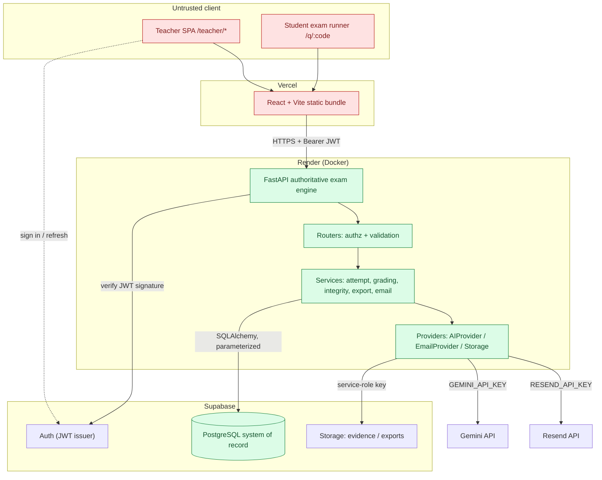
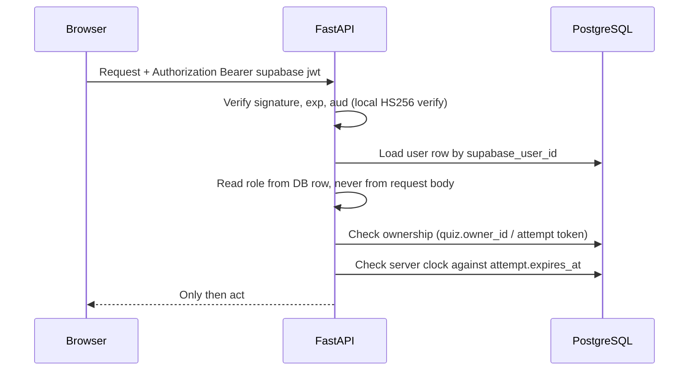
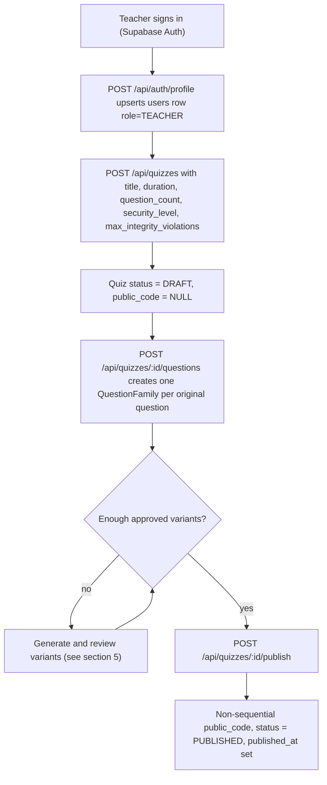
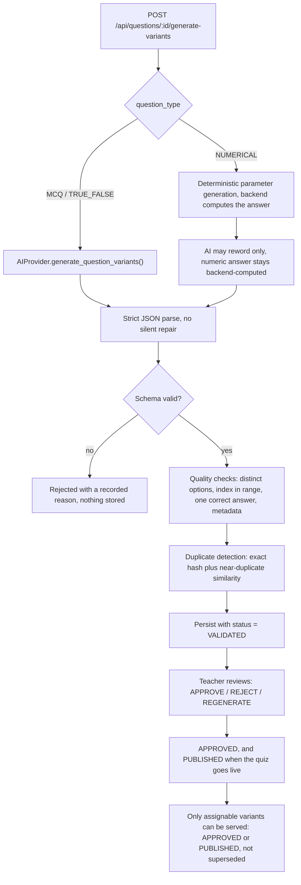
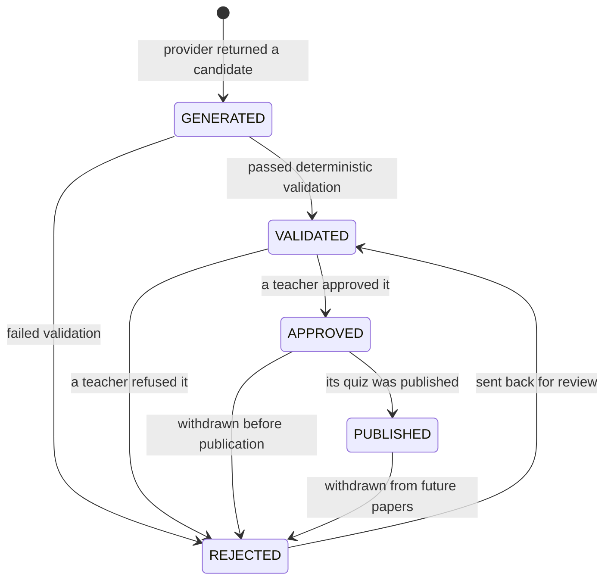
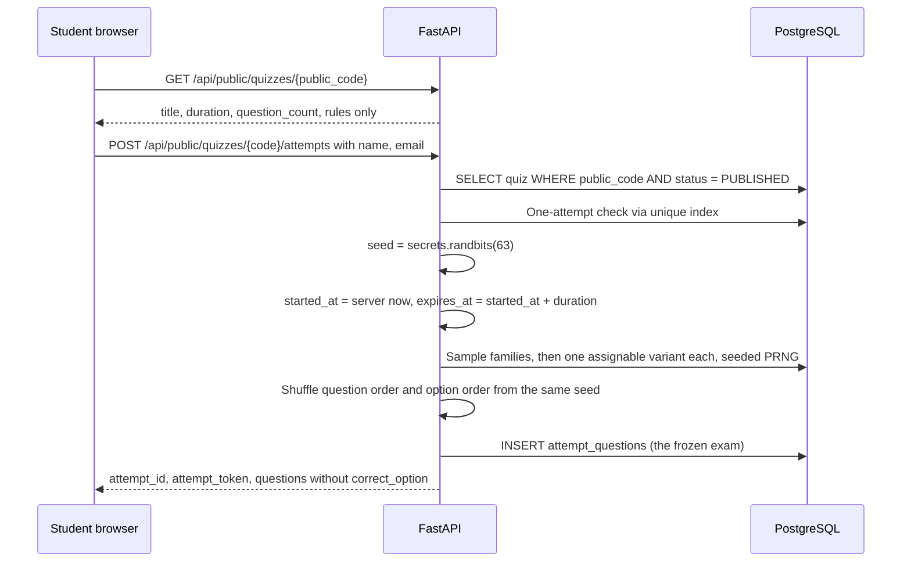
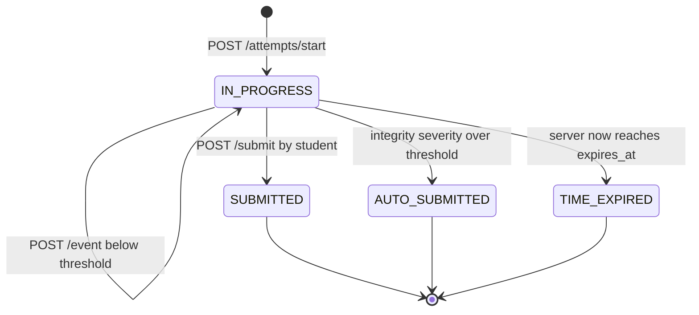
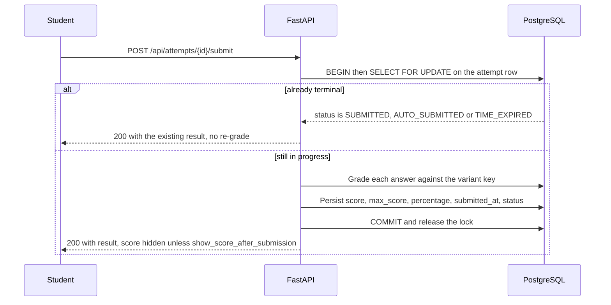
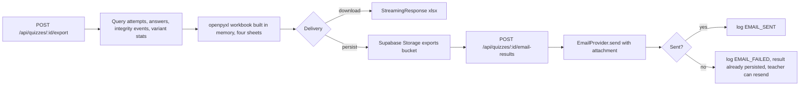

# Architecture

## 1. Guiding principle

**The browser is an untrusted client.** Every decision below follows from that.
The React app renders state and reports signals; it never decides what a student
sees, how long they have, or what they scored. The FastAPI backend is the only
authority, and Supabase PostgreSQL is the only system of record.

## 2. Component overview

| Concern | Technology | Where it runs |
|---|---|---|
| Teacher + student UI | React 19, TypeScript, Vite, Tailwind | Vercel (static CDN) |
| API / exam engine | FastAPI, Pydantic v2, SQLAlchemy 2, Alembic | Render (Docker) |
| Relational store | Supabase PostgreSQL | Supabase |
| Identity | Supabase Auth (JWT) | Supabase |
| Files (evidence, exports) | Supabase Storage | Supabase |
| Question variant generation | Gemini API via `AIProvider` | called from backend only |
| Result delivery | Resend API via `EmailProvider` | called from backend only |
| Spreadsheet export | openpyxl | backend, in-memory |

### 2.1 System architecture



Red = untrusted, green = the security boundary. Secrets exist only inside the
green zone. The frontend receives the Supabase **anon** key and nothing else.

## 3. Request authority model



Role is read from the `users` table, not from the JWT payload or request body.
A JWT proves *who*; the database decides *what they may do*.

## 4. Quiz creation



Publishing is refused unless the quiz has at least `question_count` families
with an assignable variant, and every assignable variant passes structural
checks (distinct options, exactly one correct answer in range, a
backend-computed numeric answer where applicable). `GET /readiness` returns the
same blockers without attempting to publish, so the UI can explain them before
the teacher presses the button.

## 5. Question generation




### 5.1 Variant lifecycle



Only a human performs `VALIDATED -> APPROVED`. The transition table in
`services/variant_lifecycle.py` has no path from `GENERATED` to `APPROVED`, and
a test asserts it, so approval cannot become automatic by configuration.

`APPROVED` and `PUBLISHED` variants are **content-immutable**: editing one
creates a new version and marks the original superseded, so a question already
served to a student never changes. See
[database.md](./database.md#variant-immutability-and-versioning).

10 originals x 5 variants = a **pool of 50**, not four fixed papers. See
[ai-generation.md](./ai-generation.md).

## 6. Attempt creation — one link, different exams



The exam is **frozen at creation**: `attempt_questions` rows are never
regenerated. Reloading the page replays the same paper; a different student
starting from the same URL gets a different draw because the seed differs.

Families are sampled first and one variant is drawn per family, so a student is
never given two variants of the same question. `ORDER BY random() LIMIT n` is
deliberately not used — it would do exactly that. The seed comes from
`secrets.randbits(63)` server-side; no request field can supply one, and the
whole paper is reproducible from the seed stored on the attempt row.

No AI provider is called here. Generation happens during quiz preparation, so an
exam never depends on a third party being reachable.

## 7. Exam lifecycle



`SUBMITTED`, `AUTO_SUBMITTED` and `TIME_EXPIRED` are terminal. Any later request
returns the stored result; an attempt is never reopened.

Expiry is enforced lazily on every protected request *and* eagerly at submit — a
student who closes the laptop still ends up with a graded, finalized
`TIME_EXPIRED` attempt the next time anything touches it.

## 8. Submission



A second concurrent `POST /submit` blocks on the row lock, then observes the
terminal state and returns the same result. One finalization, one email.

## 9. Export and email



Excel is an export format. PostgreSQL is the database. An email failure never
costs a result.

## 10. Backend layering

```
app/api/routes/    HTTP shape, authn/authz dependencies, Pydantic in/out
app/services/      Business rules. The only place that mutates exam state.
                     ownership.py            teacher tenant isolation
                     quiz_service.py         quiz CRUD, publish/unpublish/close
                     publish_rules.py        publish eligibility and blockers
                     family_service.py       question family CRUD
                     variant_service.py      generation, editing, supersession
                     variant_lifecycle.py    the variant state machine
                     selection.py            eligibility + seeded paper planning
                     attempt_access.py       student attempt authorization
                     attempt_service.py      attempt creation, paper assembly,
                                             sanitized delivery, answer saving
                     integrity_policy.py     severity table and threshold policy
                     attempt_finalization.py idempotent finalization
                     grading.py              scoring, at finalization only
app/db/models/     SQLAlchemy ORM, enums, constraints
app/ai/            AIProvider abstraction, GeminiProvider, validation, dedupe
app/email/         EmailProvider abstraction, ResendEmailProvider
app/storage/       Supabase Storage client
app/core/          config, logging, auth, rate limiting, server clock, errors
```

Routers never mutate exam state directly; services never import FastAPI. That
keeps the exam engine unit-testable without HTTP.

## 11. What this architecture deliberately does not include

No Kubernetes, no message broker, no Redis, no separate AI/grading/export
services. Variant generation is the only slow operation and it happens during
quiz preparation, not during an exam, so a background task inside the API
process is sufficient. A queue would be justified only by real generation
volume, and that threshold has not been reached.
