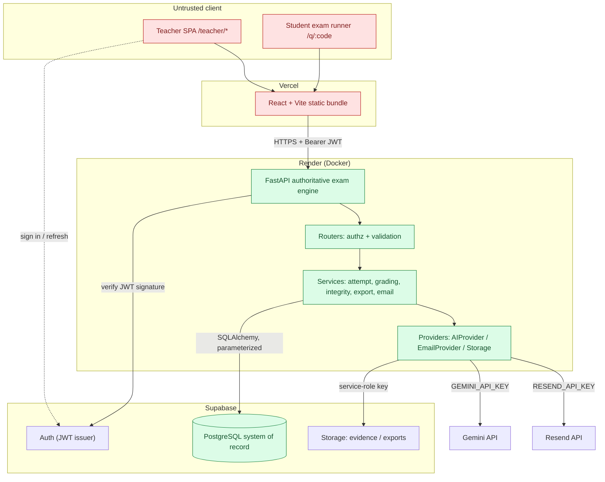
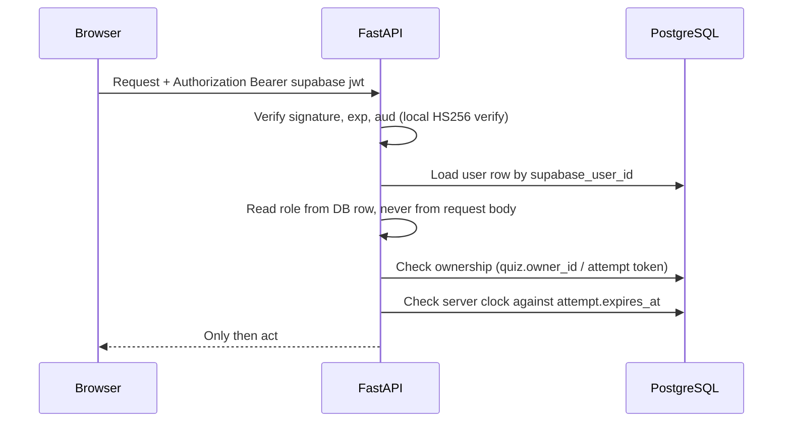
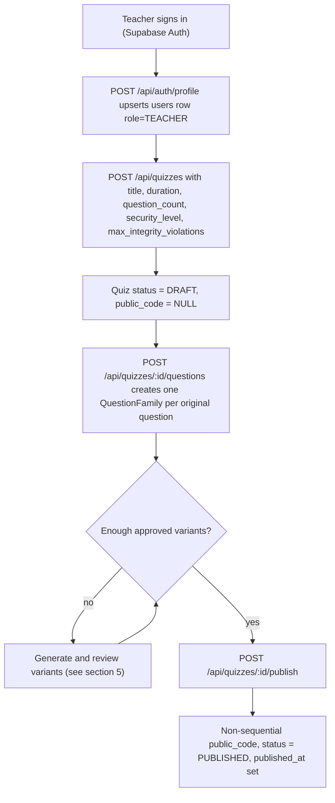
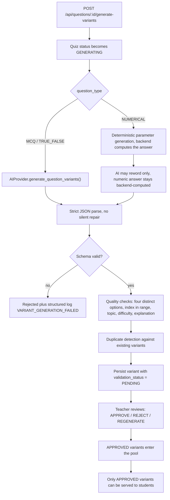
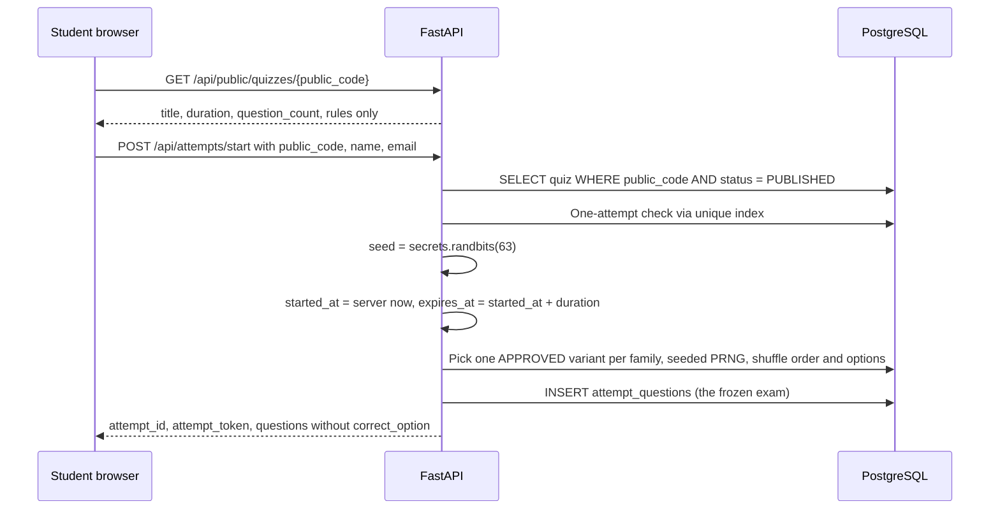
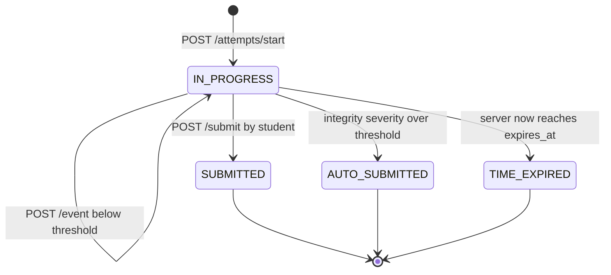
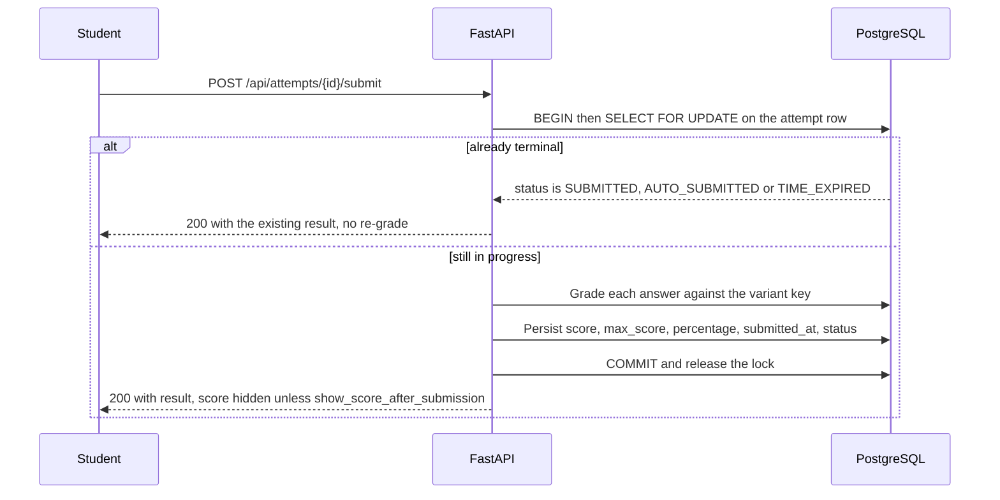
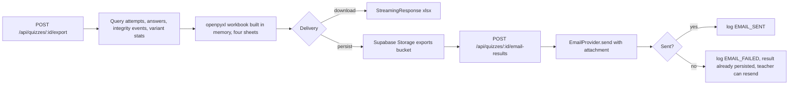

# Architecture

## 1. Guiding principle

**The browser is an untrusted client.** Every decision below follows from that.
The React app renders state and reports signals; it never decides what a student
sees, how long they have, or what they scored. The FastAPI backend is the only
authority, and Supabase PostgreSQL is the only system of record.

## 2. Component overview

| Concern | Technology | Where it runs |
|---|---|---|
| Teacher + student UI | React 19, TypeScript, Vite, Tailwind | Vercel (static CDN) |
| API / exam engine | FastAPI, Pydantic v2, SQLAlchemy 2, Alembic | Render (Docker) |
| Relational store | Supabase PostgreSQL | Supabase |
| Identity | Supabase Auth (JWT) | Supabase |
| Files (evidence, exports) | Supabase Storage | Supabase |
| Question variant generation | Gemini API via `AIProvider` | called from backend only |
| Result delivery | Resend API via `EmailProvider` | called from backend only |
| Spreadsheet export | openpyxl | backend, in-memory |

### 2.1 System architecture



Red = untrusted, green = the security boundary. Secrets exist only inside the
green zone. The frontend receives the Supabase **anon** key and nothing else.

## 3. Request authority model



Role is read from the `users` table, not from the JWT payload or request body.
A JWT proves *who*; the database decides *what they may do*.

## 4. Quiz creation



Publishing is refused unless the quiz has at least `question_count` families and
every one of them has at least one `APPROVED` variant.

## 5. Question generation



10 originals x 5 variants = a **pool of 50**, not four fixed papers. See
[ai-generation.md](./ai-generation.md).

## 6. Attempt creation — one link, different exams



The exam is **frozen at creation**: `attempt_questions` rows are never
regenerated. Reloading the page replays the same paper; a different student
starting from the same URL gets a different draw because the seed differs.

## 7. Exam lifecycle



`SUBMITTED`, `AUTO_SUBMITTED` and `TIME_EXPIRED` are terminal. Any later request
returns the stored result; an attempt is never reopened.

Expiry is enforced lazily on every protected request *and* eagerly at submit — a
student who closes the laptop still ends up with a graded, finalized
`TIME_EXPIRED` attempt the next time anything touches it.

## 8. Submission



A second concurrent `POST /submit` blocks on the row lock, then observes the
terminal state and returns the same result. One finalization, one email.

## 9. Export and email



Excel is an export format. PostgreSQL is the database. An email failure never
costs a result.

## 10. Backend layering

```
app/api/routes/    HTTP shape, authn/authz dependencies, Pydantic in/out
app/services/      Business rules. The only place that mutates exam state.
app/db/models/     SQLAlchemy ORM, enums, constraints
app/ai/            AIProvider abstraction, GeminiProvider, validation, dedupe
app/email/         EmailProvider abstraction, ResendEmailProvider
app/storage/       Supabase Storage client
app/core/          config, logging, auth, rate limiting, server clock, errors
```

Routers never mutate exam state directly; services never import FastAPI. That
keeps the exam engine unit-testable without HTTP.

## 11. What this architecture deliberately does not include

No Kubernetes, no message broker, no Redis, no separate AI/grading/export
services. Variant generation is the only slow operation and it happens during
quiz preparation, not during an exam, so a background task inside the API
process is sufficient. A queue would be justified only by real generation
volume, and that threshold has not been reached.
