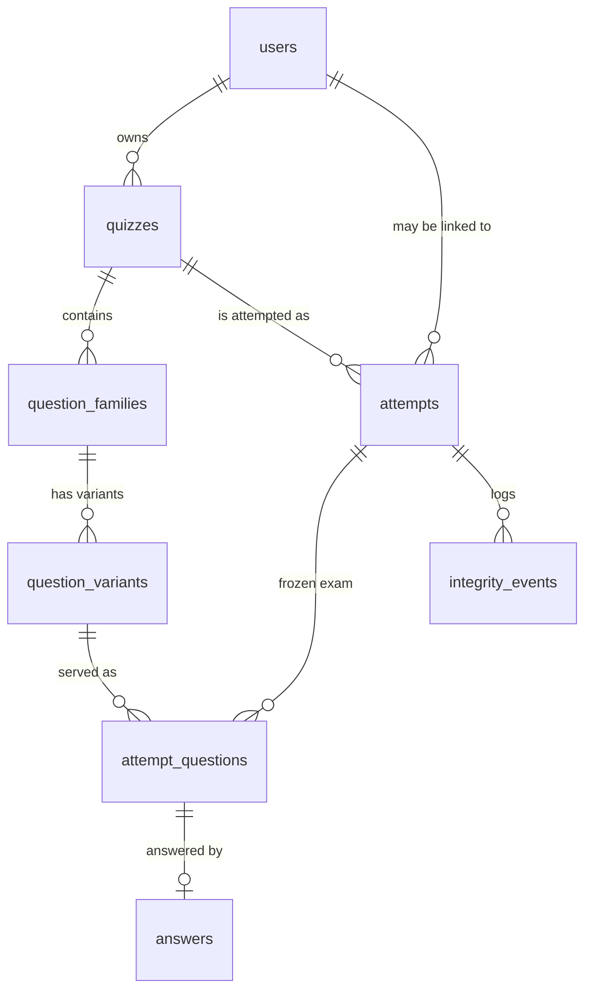

# Database

Supabase PostgreSQL is the single system of record. Every schema change ships as
an Alembic migration; nothing is altered by hand in the Supabase SQL editor.

All primary keys are `uuid` generated application-side (`uuid4`) so that inserts
do not depend on a database extension. All timestamps are `timestamptz` and are
written from the **database/server clock**, never from a client-supplied value.

## Entity relationships



## Enumerated types

Enums are stored as PostgreSQL native enum types so the database rejects invalid
states outright.

| Type | Values |
|---|---|
| `user_role` | `TEACHER`, `STUDENT`, `ADMIN` |
| `quiz_status` | `DRAFT`, `GENERATING`, `READY`, `PUBLISHED`, `CLOSED`, `ARCHIVED` |
| `security_level` | `STANDARD`, `SECURE`, `STRICT` |
| `question_type` | `MCQ`, `NUMERICAL`, `TRUE_FALSE`, `SHORT_ANSWER` |
| `generation_status` | `AI_GENERATED`, `DETERMINISTIC`, `MANUAL`, `FAILED` |
| `validation_status` | `PENDING`, `APPROVED`, `REJECTED` |
| `attempt_status` | `IN_PROGRESS`, `SUBMITTED`, `AUTO_SUBMITTED`, `TIME_EXPIRED`, `ABANDONED` |
| `integrity_status` | `CLEAN`, `WARNING`, `FLAGGED` |
| `integrity_event_type` | 20 values, listed in [security.md](./security.md) |
| `integrity_action` | `NONE`, `LOGGED`, `WARNING_ISSUED`, `AUTO_SUBMITTED` |

## Tables

### users

| Column | Type | Notes |
|---|---|---|
| `id` | uuid PK | |
| `supabase_user_id` | varchar(64) NOT NULL UNIQUE | `sub` claim of the Supabase JWT |
| `name` | text NOT NULL | |
| `email` | varchar(320) NOT NULL UNIQUE | lowercased on write, so uniqueness is case-insensitive without the citext extension |
| `role` | `user_role` NOT NULL DEFAULT `TEACHER` | authoritative role, never taken from the client |
| `created_at` | timestamptz NOT NULL DEFAULT now() | |

### quizzes

| Column | Type | Notes |
|---|---|---|
| `id` | uuid PK | |
| `owner_id` | uuid FK -> users.id, ON DELETE CASCADE | |
| `public_code` | varchar(16) UNIQUE NULL | non-sequential, assigned at publish |
| `title` | text NOT NULL | |
| `description` | text NULL | |
| `duration_seconds` | int NOT NULL, CHECK 60..28800 | |
| `question_count` | int NOT NULL, CHECK 1..200 | how many questions each student receives |
| `security_level` | `security_level` NOT NULL DEFAULT `SECURE` | |
| `max_integrity_violations` | int NOT NULL DEFAULT 2, CHECK >= 0 | cumulative **severity** budget |
| `randomization_enabled` | bool NOT NULL DEFAULT true | |
| `allow_backtracking` | bool NOT NULL DEFAULT true | |
| `show_score_after_submission` | bool NOT NULL DEFAULT false | |
| `status` | `quiz_status` NOT NULL DEFAULT `DRAFT` | |
| `created_at` / `published_at` | timestamptz | |

Indexes: `(owner_id, created_at DESC)`, unique `(public_code)`.

### question_families

One row per original question written by the teacher. A family is the unit that
a student's exam draws **one** variant from.

| Column | Type | Notes |
|---|---|---|
| `id` | uuid PK | |
| `quiz_id` | uuid FK -> quizzes.id, ON DELETE CASCADE | |
| `original_question` | text NOT NULL | |
| `question_type` | `question_type` NOT NULL | |
| `topic` | text NULL | |
| `difficulty` | text NULL | `easy` / `medium` / `hard` |
| `learning_objective` | text NULL | |
| `generation_config_json` | jsonb NOT NULL DEFAULT '{}' | variant count, numeric template, parameter ranges |
| `position` | int NOT NULL | teacher-facing ordering |
| `created_at` | timestamptz | |

Index: `(quiz_id, position)`.

### question_variants

| Column | Type | Notes |
|---|---|---|
| `id` | uuid PK | |
| `family_id` | uuid FK -> question_families.id, ON DELETE CASCADE | |
| `question_text` | text NOT NULL | |
| `options_json` | jsonb NULL | array of option strings, canonical order |
| `correct_option` | int NULL | index into `options_json`. **Never leaves the backend.** |
| `numeric_answer_json` | jsonb NULL | `{value, tolerance, unit}` for NUMERICAL |
| `explanation` | text NULL | |
| `generation_model` | text NULL | e.g. `gemini-2.5-flash` |
| `generation_prompt_version` | text NULL | prompt versioning for auditability |
| `generation_status` | `generation_status` NOT NULL | |
| `validation_status` | `validation_status` NOT NULL DEFAULT `PENDING` | |
| `content_hash` | varchar(64) NOT NULL | normalized SHA-256, backs duplicate detection |
| `rejection_reason` | text NULL | |
| `created_at` | timestamptz | |

Constraints:
- `UNIQUE (family_id, content_hash)` — the database itself refuses exact duplicates.
- `CHECK (correct_option IS NULL OR correct_option >= 0)`.
- Index `(family_id, validation_status)` — the hot path when building an exam.

Per-type shape (an MCQ must carry four options and a key) is enforced in the
validation pipeline rather than by a CHECK, because `question_type` lives on the
family rather than on the variant row.

### attempts

| Column | Type | Notes |
|---|---|---|
| `id` | uuid PK | |
| `quiz_id` | uuid FK -> quizzes.id | |
| `student_user_id` | uuid FK -> users.id NULL | set when a student is signed in |
| `student_name` | text NOT NULL | |
| `student_email` | varchar(320) NOT NULL | lowercased on write; the identity the one-attempt rule keys on |
| `attempt_token_hash` | varchar(64) NOT NULL | SHA-256 of the bearer token given to anonymous students |
| `started_at` | timestamptz NOT NULL | **server** clock |
| `expires_at` | timestamptz NOT NULL | `started_at + duration_seconds` |
| `submitted_at` | timestamptz NULL | |
| `status` | `attempt_status` NOT NULL DEFAULT `IN_PROGRESS` | |
| `seed` | bigint NOT NULL | cryptographically generated, drives the draw |
| `score` / `max_score` | numeric(8,2) NULL | server-computed only |
| `percentage` | numeric(5,2) NULL | |
| `integrity_violation_count` | int NOT NULL DEFAULT 0 | cumulative severity, not event count |
| `integrity_status` | `integrity_status` NOT NULL DEFAULT `CLEAN` | |
| `results_emailed_at` | timestamptz NULL | suppresses duplicate result emails |
| `created_at` | timestamptz | |

One-attempt enforcement: `UNIQUE (quiz_id, student_email)`. The database, not
the application, is the thing that makes a second attempt impossible — so a race
between two simultaneous `POST /attempts/start` calls ends in an integrity error
rather than two papers.

### attempt_questions

The frozen exam. Written once at attempt creation and never regenerated.

| Column | Type | Notes |
|---|---|---|
| `id` | uuid PK | |
| `attempt_id` | uuid FK -> attempts.id, ON DELETE CASCADE | |
| `variant_id` | uuid FK -> question_variants.id | |
| `position` | int NOT NULL | 0-based order for this student |
| `options_order_json` | jsonb NULL | permutation of canonical option indices |

Constraints: `UNIQUE (attempt_id, position)`, `UNIQUE (attempt_id, variant_id)`.

`options_order_json` is the mapping from displayed position to canonical index.
The student sends back a **displayed** index; the backend maps it through this
permutation before comparing with `correct_option`. The permutation lives in the
database, so a student cannot infer the key by replaying a request.

### answers

| Column | Type | Notes |
|---|---|---|
| `id` | uuid PK | |
| `attempt_question_id` | uuid FK UNIQUE -> attempt_questions.id, ON DELETE CASCADE | one answer per question, upserted |
| `selected_answer` | jsonb NOT NULL | `{displayed_index}` or `{value}` or `{text}` |
| `is_correct` | bool NULL | **null until grading**; never written from a request |
| `answered_at` | timestamptz NOT NULL | server clock |

`is_correct` is deliberately left null while the exam runs. Grading happens once,
at finalization, so a mid-exam database read cannot leak correctness.

### integrity_events

| Column | Type | Notes |
|---|---|---|
| `id` | uuid PK | |
| `attempt_id` | uuid FK -> attempts.id, ON DELETE CASCADE | |
| `event_type` | `integrity_event_type` NOT NULL | |
| `severity` | int NOT NULL | assigned **server-side** from the policy table |
| `occurred_at` | timestamptz NOT NULL | server receipt time |
| `client_reported_at` | timestamptz NULL | kept for forensics, never trusted |
| `metadata_json` | jsonb NOT NULL DEFAULT '{}' | size-capped |
| `action_taken` | `integrity_action` NOT NULL DEFAULT `LOGGED` | |

Index: `(attempt_id, occurred_at)` — powers the attempt timeline view.

## Integrity and concurrency rules encoded in the schema

1. `UNIQUE (quiz_id, student_email)` on `attempts` — one attempt per student.
2. `UNIQUE (attempt_id, position)` on `attempt_questions` — a stable paper.
3. `UNIQUE (attempt_question_id)` on `answers` — an upsert, never a duplicate row.
4. `UNIQUE (family_id, content_hash)` on `question_variants` — no duplicate variants.
5. `SELECT ... FOR UPDATE` on `attempts` during submission — exactly one finalization.

## Migrations

```bash
cd backend
alembic revision --autogenerate -m "describe change"   # review the diff by hand
alembic upgrade head
alembic downgrade -1                                    # every migration is reversible
```

`alembic/env.py` reads `ALEMBIC_DATABASE_URL` when set (Supabase direct
connection, port 5432) and falls back to `DATABASE_URL`. Migrations must not run
through the pgBouncer transaction pooler.
